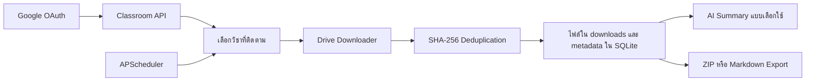

# Classroom Automation & AI Assistant

เว็บแอปสำหรับเชื่อม Google Classroom และ Google Drive เพื่อเลือกติดตามรายวิชา ซิงค์ไฟล์ เก็บ metadata ป้องกันไฟล์ซ้ำ ตั้งเวลาซิงค์ และสรุปเนื้อหาเอกสารผ่าน AI provider ที่ผู้ใช้ตั้งค่า

> สถานะ: MVP สำหรับรันบนเครื่อง การทำงานกับ Classroom/Drive ต้องใช้ Google OAuth credentials ของผู้ทดสอบเอง งานปรับปรุงเอกสารนี้ไม่เชื่อมบัญชีจริง ไม่ดาวน์โหลดเอกสารจริง และไม่เรียกบริการ AI แบบเสียเงิน

## ความสามารถที่ตรวจสอบได้จากโค้ด

- Google OAuth 2.0 พร้อม PKCE และ token refresh
- อ่านรายวิชาและไฟล์แนบผ่าน Google Classroom API กับ Drive API
- ติดตามรายวิชาและสั่ง sync รายวิชาหรือทุกวิชา
- ตรวจไฟล์ซ้ำด้วย SHA-256 และเก็บ metadata ใน SQLite
- ตั้ง scheduled sync ผ่าน APScheduler
- สกัดข้อความจาก PDF/TXT/Markdown และเชื่อม Gemini, OpenAI หรือ Ollama
- ส่งออกไฟล์รายวิชาเป็น ZIP หรือรวมข้อความเป็น Markdown
- Dashboard แบบ HTML/CSS/JavaScript และ REST API ผ่าน FastAPI

## Workflow



## เทคโนโลยี

| ส่วน | เทคโนโลยี |
|---|---|
| API | Python, FastAPI, Uvicorn |
| Data | SQLite, SQLAlchemy |
| Automation | APScheduler |
| Integration | Google Classroom API, Google Drive API, OAuth 2.0 |
| Document/AI | PyPDF2, Gemini, OpenAI, Ollama |
| UI | HTML, CSS, JavaScript |

## โครงสร้างโปรเจกต์

```text
webscraping-classroom-ai/
├── app/
│   ├── api/             # auth, courses, files, schedules, AI และ export routes
│   ├── auth/            # Google OAuth flow
│   ├── scraper/         # Classroom/Drive integration และ deduplication
│   ├── scheduler/       # scheduled sync jobs
│   ├── summarizer/      # text extraction และ AI providers
│   ├── static/          # dashboard
│   ├── config.py
│   ├── database.py
│   └── main.py
├── credentials/         # gitignored; client_secret.json และ token.json
├── data/                # SQLite database
├── downloads/           # ไฟล์ที่ซิงค์และ export
├── .env.example
└── requirements.txt
```

## ติดตั้งบนเครื่อง

### 1. เตรียม Python environment

```powershell
git clone https://github.com/BossZY27/webscraping-classroom-ai.git
cd webscraping-classroom-ai
python -m venv .venv
.\.venv\Scripts\Activate.ps1
python -m pip install -r requirements.txt
Copy-Item .env.example .env
```

สำหรับ macOS/Linux ให้ activate ด้วย `source .venv/bin/activate`

### 2. เตรียม Google OAuth

1. สร้าง project ใน Google Cloud Console
2. เปิด Google Classroom API และ Google Drive API
3. ตั้ง OAuth consent screen และเพิ่มบัญชีทดสอบของตนเอง
4. สร้าง OAuth client ชนิด **Web application**
5. เพิ่ม redirect URI `http://127.0.0.1:8000/api/auth/callback`
6. ดาวน์โหลด JSON แล้วบันทึกเป็น `credentials/client_secret.json`

ไฟล์ credentials และ token เป็นข้อมูลลับและถูกแยกออกจาก Git ผ่าน `.gitignore` ห้ามนำค่าจริงขึ้น repository

### 3. Environment variables

ค่าต่อไปนี้ตรงกับ `app/config.py` และ `.env.example`:

| ตัวแปร | ค่าเริ่มต้น/หน้าที่ |
|---|---|
| `GOOGLE_CLIENT_ID` | ประกาศไว้ใน config; OAuth flow ปัจจุบันยังอ่านค่าจากไฟล์ JSON |
| `GOOGLE_CLIENT_SECRET` | ประกาศไว้ใน config; OAuth flow ปัจจุบันยังอ่านค่าจากไฟล์ JSON |
| `GOOGLE_PROJECT_ID` | ประกาศไว้ใน config; ยังไม่ถูกใช้ใน OAuth flow ปัจจุบัน |
| `OAUTH_REDIRECT_URI` | callback URL; ค่าเริ่มต้นชี้มาที่พอร์ต 8000 |
| `DATABASE_URL` | SQLite connection string |
| `HOST` | host ที่ Uvicorn bind |
| `PORT` | port ของเว็บ |

OAuth implementation ปัจจุบันอ่าน client configuration จาก `credentials/client_secret.json` ส่วนค่า `GOOGLE_CLIENT_ID`, `GOOGLE_CLIENT_SECRET` และ `GOOGLE_PROJECT_ID` มีอยู่ใน settings แต่ยังไม่ถูกนำไปสร้าง flow โดยตรง

### 4. เริ่มระบบ

```powershell
python -m app.main
```

หรือ:

```powershell
python -m uvicorn app.main:app --host 127.0.0.1 --port 8000 --reload
```

เปิด:

- Dashboard: `http://127.0.0.1:8000/`
- API documentation: `http://127.0.0.1:8000/docs`
- Health check: `http://127.0.0.1:8000/api/health`

## ตัวอย่าง Workflow

ตัวอย่างนี้เป็นสถานการณ์สังเคราะห์ ไม่ได้อ้างอิงข้อมูลจากห้องเรียนจริง:

1. ผู้ใช้เชื่อมบัญชี Google test user
2. เลือกวิชา “Automation Fundamentals” แล้วเปิดการติดตาม
3. สั่ง sync; ระบบตรวจไฟล์แนบและ hash ก่อนบันทึก
4. เปิดรายการไฟล์ที่ดาวน์โหลดแล้ว
5. เลือกไฟล์ PDF เพื่อสรุป หรือ export เนื้อหาของรายวิชาเป็น Markdown

ตัวอย่าง health response ที่สอดคล้องกับ route:

```json
{
  "status": "ok",
  "version": "1.0.0"
}
```

## API ที่ตรวจพบ

| Method | Endpoint | หน้าที่ |
|---|---|---|
| `GET` | `/api/health` | ตรวจสถานะ service |
| `GET` | `/api/auth/status` | ตรวจสถานะ Google OAuth |
| `GET` | `/api/auth/login` | เริ่ม OAuth flow |
| `GET` | `/api/auth/callback` | รับ OAuth callback |
| `POST` | `/api/auth/logout` | ล้าง token |
| `GET` | `/api/courses/` | รายการรายวิชา |
| `POST` | `/api/courses/sync/all` | sync ทุกวิชาที่ติดตาม |
| `POST` | `/api/courses/{course_id}/track` | เปิด/ปิดการติดตาม |
| `POST` | `/api/courses/{course_id}/sync` | sync รายวิชา |
| `GET` | `/api/files/` | รายการไฟล์ |
| `GET` | `/api/files/{file_id}/download` | ดาวน์โหลดไฟล์ที่บันทึกไว้ |
| `GET/POST` | `/api/ai/settings` | อ่านหรือบันทึก AI settings |
| `POST` | `/api/ai/summarize/{file_id}` | สรุปไฟล์ที่ระบุ |
| `GET` | `/api/ai/summary/{file_id}` | อ่านผลสรุปเดิม |
| `GET` | `/api/export/{course_id}/zip` | export รายวิชาเป็น ZIP |
| `GET` | `/api/export/{course_id}/text` | export ข้อความรวมเป็น Markdown |
| `GET/POST/DELETE` | `/api/schedule/...` | จัดการ scheduled sync |

## ตรวจคุณภาพแบบไม่ใช้บัญชีจริง

```powershell
python -m compileall app
```

การทดสอบ OAuth, Classroom, Drive และ AI provider เป็น integration test ที่ต้องใช้บัญชีและ credentials ภายนอก จึงไม่ได้รวมไว้ในคำสั่งตรวจแบบ offline

## ข้อจำกัดและความปลอดภัย

- ใช้เฉพาะบัญชีทดสอบที่เพิ่มใน OAuth consent screen และอนุญาต scope ที่จำเป็น
- ห้ามแชร์ `credentials/client_secret.json`, `credentials/token.json`, `.env`, ฐานข้อมูล หรือไฟล์ที่ดาวน์โหลดจากห้องเรียน
- API และ dashboard ออกแบบสำหรับรันบนเครื่อง ยังไม่มีมาตรการ production เช่น user isolation, rate limiting และ centralized secret management
- คุณภาพการสรุปขึ้นกับข้อความที่สกัดได้และ AI provider ที่เลือก
- ยังไม่มี automated integration test สำหรับบริการภายนอก
